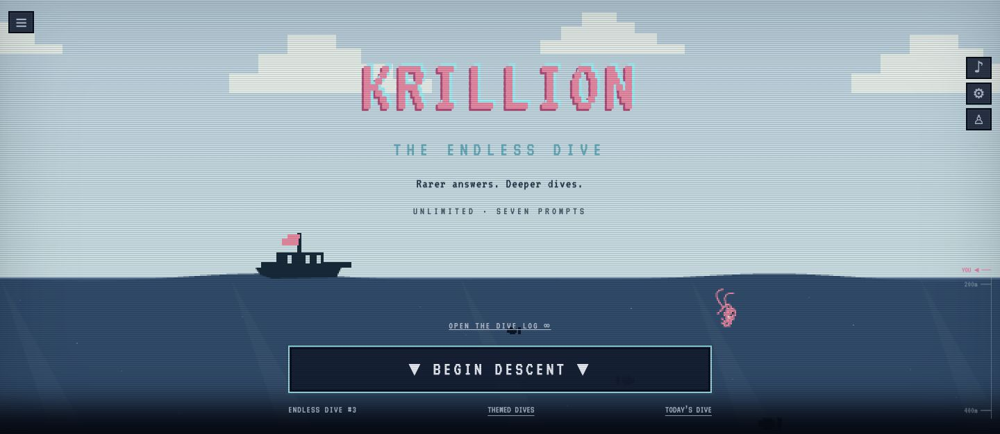

# Krillion Unlimited — 无限潜海答题

**答得越冷门，潜得越深。七题一局，免费无限重玩。**

Krillion Unlimited 是一个海洋像素风的浏览器答题小游戏。玩家回答七道题，在题库支持的答案中寻找不那么常见的答案，用得分推动角色向深海下潜。可以自由练习、参加每日挑战，也可以把同一组题分享给朋友。无需注册或安装。

**[进入正式站 →](https://unlimited-krillion.com/)** · [中文版游戏](https://unlimited-krillion.com/zh/) · [中文攻略](https://unlimited-krillion.com/zh/guides/) · [玩法说明](https://unlimited-krillion.com/zh/how-to-play/)

[English documentation](README.md)

[](https://unlimited-krillion.com/)

## 游戏怎么玩

每局七题，有效答案按题库中的熟悉度等级获得 10、30、60、85 或 100 分，满分 700 分。得分越高，下潜越深。答错可以继续尝试，跳过或超时计零分。默认每题 25 秒，也可以关闭计时。

- 无限练习，以及地理、自然、科学、食物、艺术、体育六种主题模式。
- 按 UTC 日期生成的每日七题，支持最近 30 日回放。
- 分享同题挑战链接，让朋友使用相同题组和设置。
- 结算得分图与答案回顾。
- 本地恢复未完成的游戏，保存最近 50 局、最佳成绩和平均分。
- 音效、六种角色配色、低功耗模式与色盲设置。

当前题库有 **210 道题、1,767 个答案条目、6 个类别**，每类 35 题。答案条目按题累计，不是 1,767 个全局不同词。评分来自编辑设置的熟悉度等级，没有实时玩家频率统计。无限指可以无限开局，题目会重复；目前没有跨设备排行榜。

## 七种语言直达

| 语言 | 在线游戏 |
| --- | --- |
| English | [英语版](https://unlimited-krillion.com/) |
| Español | [西班牙语版](https://unlimited-krillion.com/es/) |
| Português | [葡萄牙语版](https://unlimited-krillion.com/pt/) |
| Français | [法语版](https://unlimited-krillion.com/fr/) |
| Deutsch | [德语版](https://unlimited-krillion.com/de/) |
| 简体中文 | [中文版](https://unlimited-krillion.com/zh/) |
| 日本語 | [日语版](https://unlimited-krillion.com/ja/) |

界面、题目提示和攻略已经本地化。切换语言保留本局进度，支持已登记的本地答案及别名。英文逐题学习解释尚未全部翻译，非英语反馈使用本地化的通用回顾；别名支持也不代表所有可能的答案都已翻译。

## 网站内容与 SEO

每种语言有 16 类页面，共 **112 个独立内容地址**，覆盖游戏首页、攻略目录、玩法、计分、技巧、每日挑战、主题目录、六个分类指南、FAQ、关于和隐私政策。

- [中文计分说明](https://unlimited-krillion.com/zh/scoring/)
- [中文答题技巧](https://unlimited-krillion.com/zh/tips/)
- [主题指南](https://unlimited-krillion.com/zh/themes/)
- [常见问题](https://unlimited-krillion.com/zh/faq/)
- [隐私政策](https://unlimited-krillion.com/zh/privacy/)

攻略正文在构建时生成 HTML，具有独立标题、描述、canonical、对应语言的 hreflang 和 x-default、分享图及结构化数据。Worker 提供 [robots.txt](https://unlimited-krillion.com/robots.txt)、[XML 站点地图](https://unlimited-krillion.com/sitemap.xml) 和 [文本站点地图](https://unlimited-krillion.com/sitemap.txt)。分享题组参数页不参与索引，未知路径返回真实 404，已知页面缺少末尾斜杠时跳转到标准地址。

这些设置帮助搜索引擎发现和理解内容，不保证收录、排名或流量。

## 本地运行

需要 **Node.js 22 或更新版本**。

```sh
git clone https://github.com/guyuedumingx/krillion-unlimited.git
cd krillion-unlimited
npm ci
npm run build
npm test
npm run dev
```

打开 **http://localhost:8793/**。修改页面生成或路由后，先运行构建再测试。构建产物位于 `dist/`，`src/site-routes.js` 由构建脚本生成。

## 技术结构

游戏使用原生 JavaScript ES modules、HTML 和 CSS，没有前端框架或应用数据库。游戏进度存储在浏览器本地。Cloudflare Workers 处理路由、跳转、域名替换和 Google 标签，Static Assets 提供页面和资源，像素字体随站点托管。

| 文件 | 作用 |
| --- | --- |
| `src/app.js` | 游戏界面、流程、偏好与本地存储 |
| `src/engine.js` | 确定性题组、判分、拼写修正、分享和存档校验 |
| `src/scene.js`、`src/style.css` | 海洋场景与布局 |
| `src/bank.js`、`src/extra-bank.js` | 题库、答案、分值与学习来源 |
| `src/i18n.js` 及翻译文件 | 界面、题目与答案本地化 |
| `src/site-content.js`、`src/seo-metadata.js` | 攻略、隐私和 SEO 元数据 |
| `src/worker.js` | Cloudflare 请求处理与标签注入 |
| `scripts/build.mjs` | 页面、静态资源与路由清单构建 |
| `tests/` | 游戏、语言、SEO 与 Worker 测试 |
| `wrangler.jsonc` | 部署配置 |

## 部署到 Cloudflare

```sh
npx wrangler login
npm run deploy
```

部署自己的副本前，在 `wrangler.jsonc` 修改 Worker 的 `name`、`vars.SITE_ORIGIN` 和 `routes`。`SITE_ORIGIN` 使用实际 HTTPS 根地址，不带末尾斜杠。如果只用 workers.dev，移除当前网站的域名路由，填写自己的 Worker 地址。

广告与统计需要使用你自己的配置：

- 未配置广告时，将 `ADSENSE_ENABLED` 设为 `"false"`。
- 启用广告时，填写自己的 `ADSENSE_PUBLISHER_ID` 和 `ADSENSE_GUIDE_SLOT`。
- `GA4_MEASUREMENT_ID` 填自己的统计 ID；空字符串关闭统计。
- 在 `src/index.html` 和 `scripts/build.mjs` 替换或移除原有 Google 所有权验证 meta。

使用自己的 Cloudflare 账号登录，凭据不写入仓库。正式站根域采用 Worker 路由及代理 DNS，www 使用 Custom Domain；旧 Worker 地址、www 和 HTTP 都跳转至正式 HTTPS 根域。不同域名之间的浏览器本地成绩不会自动转移。

推荐使用配套 Worker。直接将 `dist/` 上传 Pages 时，需要另外处理 `__ORIGIN__`、robots、站点地图、跳转和 Worker 中的 Google 标签逻辑。完整配置说明见 [英文 README](README.md#deploy-on-cloudflare)。

## 广告、统计与隐私

正式站接入 Google AdSense 与 GA4。AdSense 已切换为 `ca-pub-1089347748089061`，网站加载脚本、所有权 meta 和 ads.txt 使用新账号。已在新账号创建响应式展示广告位 `2717459333`（Krillion Unlimited — Guide content），接入攻略区域，不再使用旧账号的广告位。下方历史审核与同意提示记录对应旧账号，新账号网站当前显示“正在准备”，CMP 配置尚未核验。配置有效广告位后，展示广告位放在首页攻略区和指南正文后，接近可视区域才请求；答题时攻略区隐藏，关于和隐私页没有手动放置的攻略展示广告位。

GA4 在成功返回的 HTML 内容页加载一次，404 不加载。统计页面地址和来源地址去掉查询参数，不把游戏答案、存档和本地成绩作为自定义统计事件发送。Google Signals 和统计标签的广告个性化信号已关闭。

Google 同意配置默认四类状态为 denied，采用 Advanced Consent Mode，代码保留通过 Google CMP 更新同意状态的能力，新账号 CMP 后台配置尚未核验。未允许统计 Cookie 时仍可能发送无 Cookie 衡量请求。七语隐私政策说明了这些行为，适用且 Google CMP 就绪时提供同意设置入口。

截至 **2026-10-10 的实施记录**：Google 已确认 GA4 标签安装；实际报表入库仍待确认。GSC 域名验证和站点地图提交完成，但地图报告仍有抓取问题。AdSense 已请求审核，尚未确认获批或实际付费广告展示。完整访客同意及撤回流程仍需线上验收。这些是历史检查记录，不能当作平台当前状态保证。

详见 [发布记录](RELEASE.md) 和 [V8 线上检查](LIVE-AUDIT-V8.json)。

## 维护与验证

题目包含 ID、类别、提示、答案与别名、解释及参考链接。分值按答案列表位置映射，调整顺序会改变评分。改动题库或评分时，递增 `src/bank.js` 的 `BANK_VERSION`（当前为 `3`），避免旧挑战链接和存档悄悄换题。

新增题目要核验事实和来源、补齐语言提示、检查别名歧义。构建会验证重复 ID、答案别名、主题覆盖和翻译提示。现有 **20 项自动化测试**覆盖题组、判分、存档、分享、本地化、SEO、路由、CSP、广告和统计注入。

```sh
npm run build
npm test
```

V8 检查已覆盖 112 个线上内容页。自动化检查和模拟手机布局不替代真实设备输入测试及 Google 最终平台验收。

遇到问题或想补充题目，可以在 [GitHub Issues](https://github.com/guyuedumingx/krillion-unlimited/issues) 提交，附上语言、浏览器、题目和复现步骤。

**[访问 Krillion Unlimited，开始下一局 →](https://unlimited-krillion.com/zh/)**
